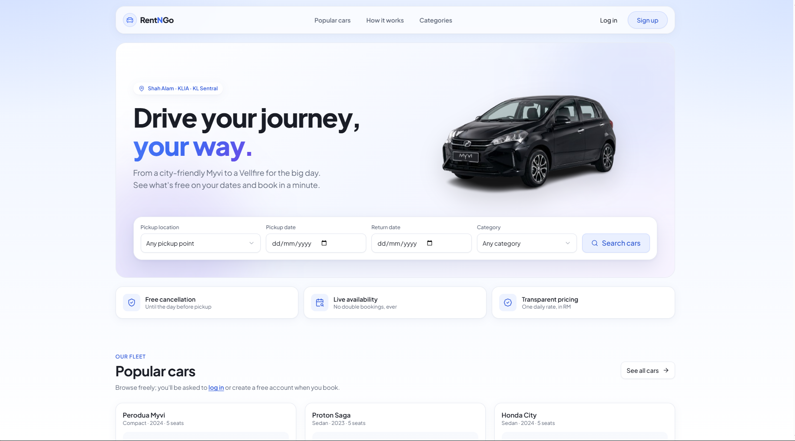
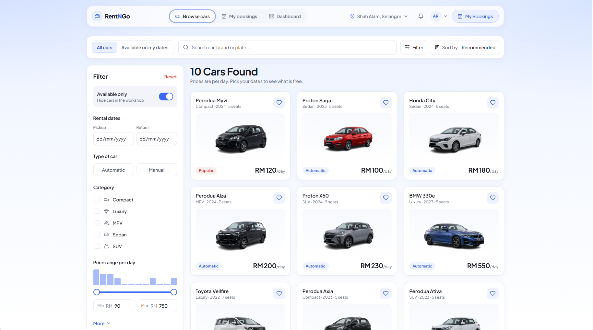
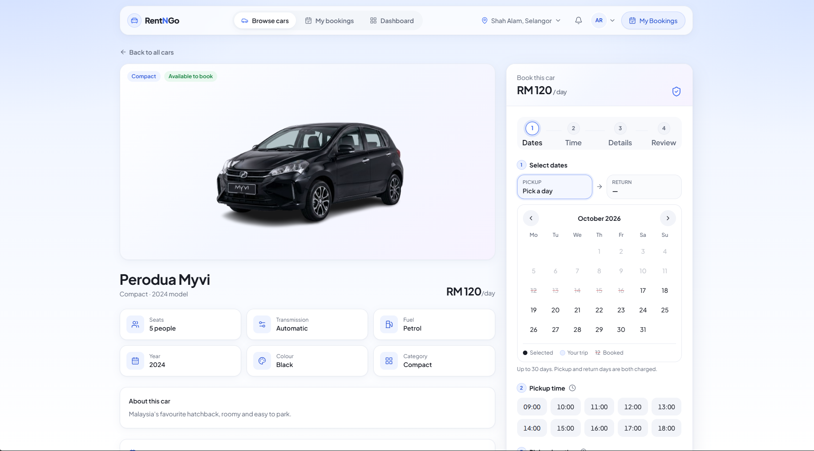
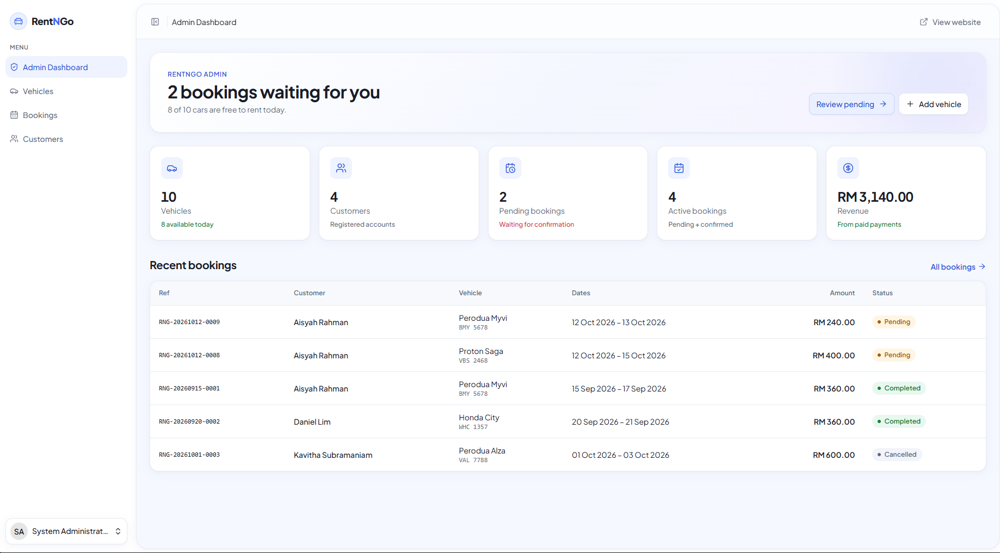

# RentNGo Car Booking System

Car rental booking system for Malaysia built with **Laravel 13, Inertia.js, React and TypeScript**. Customers browse cars, check live availability on a calendar and book with a pickup time; admins manage vehicles, bookings, payments and customers. Double-booking is blocked with row locks and database triggers.


---

## Screenshots

> Add your screenshots to `docs/screenshots/` with these names and they will show up here.

| Landing page | Browse cars |
| --- | --- |
|  |  |

| Booking with live availability | Admin dashboard |
| --- | --- |
|  |  |

---

## Features

### For customers
- **Browse cars** with search, category, transmission, seats and a price-range slider (with a price histogram), plus sorting. All filters live in the URL, so results can be bookmarked or shared.
- **Real-time availability**: pick dates and only the cars that are free for the whole trip are shown.
- **Calendar booking flow**: choose pickup and return days on a calendar (already-booked days are crossed out), pick a pickup time slot, location and payment method, then review a summary before confirming.
- **Live price**: the total (RM × days) updates and animates as the dates change.
- **My bookings**: upcoming, completed and cancelled trips, with free cancellation until the day before pickup (a paid booking is marked as refunded).
- **Profile with rental details**: phone, IC number (MyKad format) and driving license, which are required before a first booking.

### For admins
- **Dashboard** with fleet, customer, booking and revenue stats, and the latest bookings.
- **Vehicles**: add, edit and delete cars with photo upload. Cars that have bookings cannot be deleted; they are set to *inactive* instead, so booking history is kept.
- **Bookings**: search and filter, move bookings through *pending → confirmed → completed* (or cancelled) with only valid status changes allowed, and record payments.
- **Customers**: search by name, email, phone or IC, see license validity, and block or unblock accounts.

### Security and data integrity
- **No double bookings**, protected at three levels (see [How double-booking is prevented](#how-double-booking-is-prevented)).
- Role-based access: customers can't open admin pages and admins can't make bookings.
- Blocked users can't log in, and a user blocked while logged in is signed out on their next request.
- Login, availability-check and booking endpoints are rate-limited; all input goes through Form Request validation.
- Customers can only see and cancel their own bookings.

### Design and user experience
- Light, modern UI built on shadcn/ui with one set of design tokens (colours, type scale, radius, shadows).
- Subtle animations with Framer Motion: page transitions, staggered lists, sliding tab highlights, skeleton loaders while results load, and number counters. All of it respects the operating system's "reduce motion" setting.
- Fully responsive: admin tables turn into cards on phones, the filter panel becomes a slide-in sheet, and a sticky booking bar appears on mobile.
- Accessible: labelled fields, visible focus rings, announced validation errors and a "Skip to content" link.
- Toast notifications for every booking and admin action.

---

## Tech stack

| Layer | Tools |
| --- | --- |
| Backend | Laravel 13, PHP 8.3+, Laravel Fortify (authentication) |
| Frontend | React 19, TypeScript, Inertia.js 3, Laravel Wayfinder (typed routes) |
| UI | Tailwind CSS 4, shadcn/ui, lucide-react icons, Framer Motion (`motion`), react-day-picker |
| Database | MySQL / MariaDB (XAMPP); SQLite for the test suite |
| Testing | Pest |
| Tooling | Vite, Laravel Pint, oxlint / oxfmt via `vp check` |

---

## How double-booking is prevented

Two customers can try to book the same car for the same dates at the same moment. RentNGo blocks this at three levels:

1. **Live check before booking.** The booking page asks the server (`GET /cars/{vehicle}/availability`) every time the dates change and shows "available" or "already booked" with the price.
2. **Row lock while saving.** `BookingController@store` runs inside a database transaction and locks the car's row with `lockForUpdate()`. A second request for the same car waits for the first to finish, then re-checks availability and is refused.
3. **Database triggers.** On MySQL/MariaDB, `BEFORE INSERT` / `BEFORE UPDATE` triggers on `bookings` reject any pending or confirmed booking whose dates overlap another one, even if something bypasses the application.

Two date ranges overlap when *new pickup ≤ existing return* and *new return ≥ existing pickup*. Only `pending` and `confirmed` bookings block a car; cancelled and completed ones don't.

---

## Getting started

### Requirements
- PHP 8.3 or newer, with the `pdo_mysql` and `fileinfo` extensions
- Composer
- Node.js 20 or newer and npm
- MySQL or MariaDB (for example through XAMPP)

### Installation

```bash
# 1. Clone the repository
git clone https://github.com/nurathirah07/RentNGo-Car-Booking-System.git
cd RentNGo-Car-Booking-System

# 2. Install PHP and JavaScript dependencies
composer install
npm install

# 3. Create the environment file and app key
cp .env.example .env        # on Windows PowerShell: copy .env.example .env
php artisan key:generate
```

### Database

Create an empty database (e.g. `rentngo_db` in phpMyAdmin), then set these values in `.env`:

```env
APP_NAME=RentNGo
APP_URL=http://localhost:8000

DB_CONNECTION=mysql
DB_HOST=127.0.0.1
DB_PORT=3306
DB_DATABASE=rentngo_db
DB_USERNAME=root
DB_PASSWORD=
```

Then create the tables, load the sample data and link the public storage folder (needed for car photos):

```bash
php artisan migrate --seed
php artisan storage:link
```

### Run the app

```bash
composer run dev
```

Open **http://localhost:8000**. Use the same address as `APP_URL`, otherwise uploaded photos won't load.

To reset the database to the sample data at any time:

```bash
php artisan migrate:fresh --seed
```

### Car photos (optional)

Side-view car photos with a transparent background look best. Put them in `storage/app/public/vehicles/` named after the model (`axia.png`, `myvi.png`, `saga.png`, `city.png`, `x50.png`, `ativa.png`, `alza.png`, `innova.png`, `bmw330e.png`, `vellfire.png`) and run `php artisan migrate:fresh --seed`. Without photos, a neutral car silhouette is shown. Admins can also upload photos from the Vehicles page.

---

## Demo accounts

The seeder creates these accounts for local testing:

| Role | Email | Password |
| --- | --- | --- |
| Admin | `admin@rentngo.my` | `admin123` |
| Admin | `huda@rentngo.my` | `admin123` |
| Customer | `aisyah@example.com` | `customer123` |
| Customer | `daniel@example.com` | `customer123` |
| Customer | `kavitha@example.com` | `customer123` |
| Customer | `hafiz@example.com` | `customer123` |

It also creates 5 categories (Compact, Sedan, SUV, MPV, Luxury), 10 Malaysian cars (Perodua Axia to Toyota Vellfire) and sample bookings with payments.

> These are sample credentials for local development only. Change them before deploying anywhere public.

---

## Running the tests

The test suite uses Pest with an in-memory SQLite database, so it never touches your real data.

```bash
php artisan test --compact
```

It covers authentication and blocked accounts, browsing and filtering, the availability check, booking (including double-booking, pickup-time and profile rules), cancellation, and the admin vehicle, booking and customer management.

Code style and type checks:

```bash
vendor/bin/pint            # PHP formatting
npm run check              # lint + formatting (oxlint / oxfmt)
npm run types:check        # TypeScript
npm run build              # production build
```

---

## Project structure

```
app/
├── Http/Controllers/
│   ├── Admin/                     # DashboardController, VehicleController, BookingController, CustomerController
│   ├── BookingController.php      # customer bookings (create with row lock, cancel)
│   ├── CarController.php          # browse + car detail
│   └── VehicleAvailabilityController.php  # live availability JSON endpoint
├── Http/Middleware/               # EnsureUserIsAdmin, EnsureUserIsCustomer, EnsureUserIsActive
├── Http/Requests/                 # Form Request validation
└── Models/                        # User, Vehicle, Category, Booking, Payment

database/
├── migrations/                    # includes the booking overlap triggers
└── seeders/RentNGoSeeder.php      # sample cars, users and bookings

resources/
├── css/app.css                    # design tokens, type scale, utilities
└── js/
    ├── components/rentngo/        # vehicle card, booking calendar, filters, tables, motion helpers...
    ├── layouts/                   # customer top-nav, admin sidebar, auth and settings layouts
    ├── lib/motion.ts              # shared animation settings
    └── pages/                     # Inertia pages (welcome, cars, bookings, admin, auth, settings)

routes/
├── web.php                        # home + dashboard
├── customer.php                   # browse, availability, bookings
└── admin.php                      # admin area
```

---

## Possible improvements

- Online payment gateway (e.g. FPX via Billplz or ToyyibPay) instead of recording payments manually
- Email or WhatsApp notifications when a booking is confirmed
- Multiple photos per car with a gallery
- Delivery to a custom address and pickup at more locations
- Reports and charts for revenue and fleet usage

---

## Author

Built by **[nurathirah07](https://github.com/nurathirah07)** as a portfolio project.
